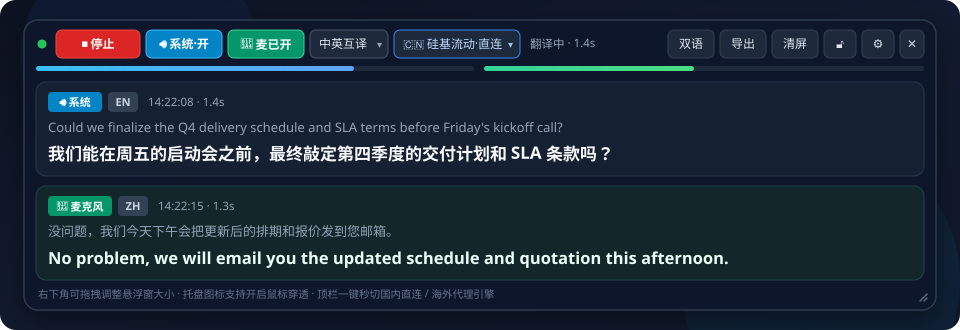
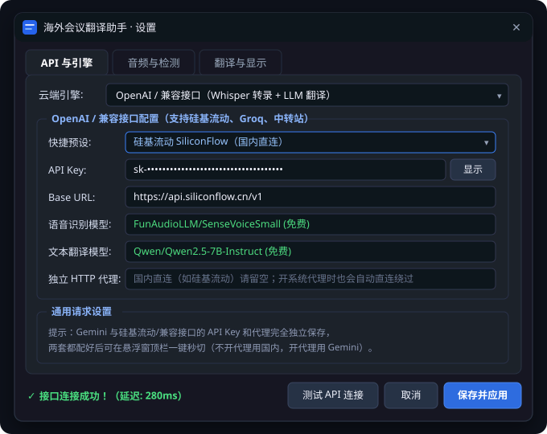

# 🌐 海外会议翻译助手（Overseas Meeting Translator）

> 一款专为 **Windows & macOS** 打造的**置顶半透明悬浮实时双语字幕工具**——零显卡要求、支持免费云端 API、国内直连与海外代理引擎一键秒切，轻松搞定**海外会议、国外朋友聊天、看无字幕外语影视剧/直播**。

[](https://github.com/nbbuesjs-create/overseas-meeting-translator)
[](https://www.python.org/downloads/)
[](LICENSE)

---

## 📸 软件界面预览

### 1. 置顶悬浮双语字幕窗口


### 2. 多引擎独立配置面板（支持国内免费直连 & 海外代理一键切换）


---

## 🎯 适用场景

| 使用场景 | 推荐音频通道 | 推荐显示/设置 | 体验亮点 |
| :--- | :--- | :--- | :--- |
| 💼 **海外线上会议**（Zoom / Teams / Google Meet / Webex） | `🔊 系统声音` 或 `🔊+🎤 双通道` | 双语对照 + 行业术语表 | 戴耳机也能直接抓对方声道，无需外放；会后一键导出 Markdown 双语纪要 |
| 🤝 **线下跨国商务 / 外宾接待** | `🎤 麦克风` | 中英双向互译（英⇄中） | 电脑摆在桌上即可听译面对面谈话，支持调高 VAD 阈值过滤环境噪音 |
| 💬 **和国外朋友语音/视频聊天**（Discord / WhatsApp / 游戏连麦） | `🔊+🎤 双通道` | 中英双向互译 | 同时标注 `[系统]` 与 `[麦克风]` 双方内容，聊天顺畅不卡壳 |
| 🎬 **看国外无字幕电视剧 / 电影 / YouTube / 海外公开课 / 直播** | `🔊 系统声音` | `极简模式` + `鼠标穿透` | 把悬浮条拖到视频底部并开启鼠标穿透，秒变实时中文字幕播放器 |

---

## ✨ 核心亮点

- **三模式灵活采集（跨平台支持 Windows & macOS）**：
  - `🔊 系统声音`：Windows 基于原生 **WASAPI Loopback** 免虚拟声卡直接抓电脑声音（戴耳机也能精准采集）；macOS 配合免费开源虚拟声卡 **BlackHole 2ch** 同样支持系统内录。
  - `🎤 麦克风`：Windows & macOS 均**开箱即用**，一键点亮即刻收音，适合线下与国外朋友/客户面对面交流。
  - `🔊+🎤 双通道同时监听`：两个按钮同时点亮，独立识别并分别标注 `[系统]` 与 `[麦克风]` 卡片。
- **双引擎独立代理 + 顶栏一键秒切**：
  - **国内免费直连（硅基流动 SiliconFlow）** 与 **海外引擎（Google Gemini / Groq / OpenAI）** 的 API Key 与代理相互独立保存。
  - **开着系统代理时切国内引擎也能自动绕过代理直连**，不绕弯、不卡顿；开会中途也能在顶栏一键切换，无需重启或重复配置。
- **零显卡要求，云端低延迟 + 防漏句重试**：
  - 无需昂贵 NVIDIA 显卡，轻薄办公本即可流畅运行。
  - 内置 `503 / 429 / 5xx` 瞬时抖动自动静默重试，降低高峰期漏句概率。
  - 内置上下文记忆 + **自定义行业术语/会议背景**，专业缩写（ARR、SLA、FOB、MOQ 等）翻译更地道。
- **顺手的桌面悬浮体验**：
  - 始终置顶、半透明暗色玻璃风格、自由拖拽移动与缩放、字号/透明度可调。
  - 一键切换**双语对照 / 极简译文**、**纯净字幕模式**、**紧凑锁定**防误触、任务栏托盘支持**鼠标穿透模式**。
  - 一键导出本场会议带时间戳的 **Markdown 双语记录**（保存于 `transcripts/` 目录）。

---

## 🚀 快速开始

### ⚡ AI 智能体一键部署（最省事 · 推荐）

把下面这句话直接复制发给你的 AI 智能体（Antigravity、Codex、Claude Code、Cursor、WorkBuddy 等），全程自动帮你拉代码、装环境、查代理并跑起来：

```text
帮我拉取 https://github.com/nbbuesjs-create/overseas-meeting-translator 的最新源码放到本地（例如 D:\overseas-meeting-translator），自动配好 Python 3.10+ 环境与依赖并启动悬浮字幕窗口；同时帮我查询本机代理端口，引导我完成免费 API（国内直连硅基流动 SiliconFlow 或海外 Google Gemini）的配置与连接测试。全过程你盯着，遇到环境、编码、代理或音频设备问题直接修复，有必要的话顺手给项目提交 Issue 帮助优化兼容性。
```

> 你唯一需要准备的，是一个免费的 API Key（下方附 **硅基流动国内免代理免费 Key** 与 **Google Gemini 免费 Key** 官方申请网址，1 分钟即可领到）。

### 🖱️ 手动安装（3 分钟上手）

#### Windows 用户
1. 安装 **Python 3.10 ~ 3.12**：前往 [Python Windows 下载页](https://www.python.org/downloads/windows/)，安装时**务必勾选 `Add python.exe to PATH`**。
2. 点击本仓库右上角绿色 **`Code`** → **`Download ZIP`** 解压到本地目录（或执行 `git clone https://github.com/nbbuesjs-create/overseas-meeting-translator.git`）。
3. 双击 **`start.bat`** 自动建虚拟环境、装依赖并打开悬浮字幕窗。
4. **（可选）添加到 Windows 开始菜单**：双击 **`install_shortcut.bat`**，即可生成专属透明图标并将「海外会议翻译助手」加入 Windows 开始菜单（右键可固定到开始屏幕或任务栏，以后启动无黑框）。

> 💡 **便携版 Python 提示**：若 Python 未加入 PATH，可在项目根目录新建 `python_path.txt`，写入 `python.exe` 完整路径（如 `D:\Python312\python.exe`）后双击 `start.bat`。

#### 🍎 macOS 用户
1. 确保已安装 **Python 3.10+**（推荐 `brew install python@3.12` 或前往 [python.org](https://www.python.org/downloads/macos/) 下载）。
2. 下载解压本仓库后，在终端进入项目目录执行一键启动：
   ```bash
   chmod +x start_mac.command && ./start_mac.command
   ```
   （首次授权后，以后直接双击 `start_mac.command` 即可运行。）
3. **macOS 音频说明**：
   - **线下聊天（`🎤 麦克风`）**：开箱即用，首次点亮麦克风时允许系统权限即可。
   - **抓取电脑系统声音（线上会议 / 看无字幕电影）**：由于 macOS 系统限制，需安装免费的开源虚拟声卡 **BlackHole 2ch**：
     1. 终端安装：`brew install blackhole-2ch`（或前往 [BlackHole 官网](https://existential.audio/blackhole/) 下载安装包）；
     2. 打开 macOS 自带的 **「音频 MIDI 设置」** → 点左下角 **`+`** → **创建多输出设备** → 同时勾选你的 **扬声器/耳机** 和 **BlackHole 2ch**；
     3. 在 macOS 系统声音输出中选择该「多输出设备」，回到本软件点亮 **`🔊 系统`** 即可自动识别 `BlackHole 2ch`！

#### 配置免费 API 并开始翻译
1. 点击悬浮窗右上角 **`⚙`** 打开设置 → **「API 与引擎」**。
2. 按下方教程申请并填入**免费 API Key**，点击 **`测试 API 连接`** 确认变绿后点击 **`保存并应用`**。
3. 回到悬浮窗顶部，点亮 **`🔊 系统`**（线上会议/看剧）或 **`🎤 麦克风`**（线下聊天），即刻开始实时翻译！

---

## 🔑 免费 API 申请与配置教程

软件内置多套云端方案，**推荐至少配置方案一（国内直连免费）**，如果电脑有代理可再配方案二（Gemini），配好后在悬浮窗顶栏随时一键切换！

### 方案一：硅基流动 SiliconFlow（🌟 最推荐 · 国内直连免代理 · 默认模型免费）

- **官方申请网址**：[https://cloud.siliconflow.cn/](https://cloud.siliconflow.cn/)
- **免费说明**：软件快捷预设默认使用的语音模型 `FunAudioLLM/SenseVoiceSmall` 与翻译模型 `Qwen/Qwen2.5-7B-Instruct` 均属于平台免费模型（限速范围内 0 成本；实际免费政策以 [硅基流动模型广场](https://cloud.siliconflow.cn/models) 最新标注为准）。

**配置步骤**：
1. 打开 [https://cloud.siliconflow.cn/](https://cloud.siliconflow.cn/) 注册并登录账号。
2. 在左侧菜单点击 **「API 密钥」** → **「新建 API 密钥」** → 复制生成的 `sk-...` 密钥。
3. 打开软件右上角 `⚙` → **「API 与引擎」**：
   - **云端引擎**：选择 `OpenAI / 兼容接口（Whisper 转录 + LLM 翻译）`
   - **快捷预设**：选择 **`硅基流动 SiliconFlow（国内直连）`**（自动填入 Base URL 与两个免费模型）
   - **API Key**：粘贴你复制的 `sk-...` 密钥
   - **独立 HTTP 代理**：**留空**（直连国内服务器，即使你电脑开着系统代理也会自动绕过）
4. 点击 **`测试 API 连接`** → 显示绿色成功 → 点击 **`保存并应用`**。

---

### 方案二：Google Gemini API（多语种 & 重口音识别极强 · 有免费额度 · 需代理）

- **官方申请网址**：[https://aistudio.google.com/apikey](https://aistudio.google.com/apikey)
- **特点**：原生多模态音频一步直出识别+翻译，支持数十种外语自动检测（英/日/韩/法/德/西/俄等），适合重口音商务会议与多语种电影。

**配置步骤**：
1. 打开 [https://aistudio.google.com/apikey](https://aistudio.google.com/apikey) 登录 Google 账号 → 点击 **Create API Key** 复制密钥。
2. 打开软件 `⚙` → **「API 与引擎」**：
   - **云端引擎**：选择 `Google Gemini API（推荐 · 单步直出低延迟）`
   - **API Key**：粘贴你的密钥
   - **Base URL**：保持默认 `https://generativelanguage.googleapis.com`
   - **模型名称**：推荐填写低延迟模型 **`gemini-3.5-flash-lite`** 或最新 **`gemini-3.8-flash`**
   - **独立 HTTP 代理**：如通过本地代理软件访问 Google，填入代理地址，例如 `http://127.0.0.1:7890`（Clash 常用 `7890` / `7897`，v2rayN 常用 `10808` / `10809`）。
     - *快捷查端口命令*：在 Windows 命令行运行 `reg query "HKCU\Software\Microsoft\Windows\CurrentVersion\Internet Settings" /v ProxyServer` 即可看到当前系统代理地址。
3. 点击 **`测试 API 连接`** → 通过后 **`保存并应用`**。

---

### 方案三：Groq 超快引擎（海外免费额度 · Whisper 极速转录 · 需代理）

- **官方申请网址**：[https://console.groq.com/keys](https://console.groq.com/keys)
- **配置步骤**：云端引擎选 `OpenAI / 兼容接口` → 快捷预设选 **`Groq 超快引擎（Whisper + Llama）`** → 粘贴 `gsk_...` 密钥并填入本地 HTTP 代理即可。
- **进阶混搭**：你还可以勾选「翻译 LLM 使用独立接口」，例如用 **Groq 语音识别 + DeepSeek（[platform.deepseek.com](https://platform.deepseek.com/)）文本翻译**。

---

## 🎮 界面操作说明

- **顶部工具栏**：
  - `▶ 开始翻译 / ⏹ 停止翻译`：启动或停止实时监听。
  - **`🔊 系统` / `🎤 麦克风`（独立一键开关）**：
    - 线下聊天/面对面交流时，直接点一下 **`🎤 麦克风`**（亮绿变为 `🎤 麦已开`）即可**立即开麦收音并开始翻译**；
    - 线上开会/看剧时，点亮 **`🔊 系统`** 抓取电脑声道；
    - 两个按钮**同时点亮**即自动进入双通道同传模式，再点任意一个即可单独关闭该声道。
  - `多语→中文 / 中英互译 / 英→中 / 中→英 / 多语→英语`：实时切换翻译方向。
  - `🌐 Gemini·代理 / 🇨🇳 硅基流动·直连`：**一键秒切翻译引擎**（无需重启、自动切换各自代理）。
  - `双语 / 极简`：切换显示「外语原文 + 译文」或「仅显示译文」（看电影推荐极简模式）。
  - `导出`：将整场会议记录保存为带时间戳的 Markdown 文件（默认在 `transcripts/` 目录）。
  - **`纯净`（纯净字幕模式）**：一键隐藏窗口内所有按钮与文字提示，仅保留悬浮字幕和顶部音量电平条；再点右上角悬浮 `👁` 图标（或按 `Esc` / 右键托盘）即可恢复。
  - `🔓 / 🔒`：紧凑锁定模式，隐藏多余按钮并防止拖动误触。
- **鼠标穿透（看电影/操作会议软件不遮挡）**：
  - 右键点击任务栏/菜单栏的**托盘图标** → 勾选 **「鼠标穿透模式」**，鼠标即可直接穿透字幕窗点击后方界面；再次右键托盘图标即可取消穿透。
- **提高专业词汇准确度**：
  - 在 `⚙` → **「翻译与显示」** → **「行业术语/背景」** 中输入你的产品名、客户公司名或行业缩写（例如 `SaaS, ARR, SLA, FOB, MOQ, SKU`），翻译准确度会大幅提升。

---

## 🛠 常见问题排查

1. **收不到系统声音（顶部电平条不跳动）**：
   - 确认目标软件（Zoom / 浏览器 / 播放器）正在发声且未静音。
   - **Windows 蓝牙耳机用户注意**：加入会议时 Windows 可能自动切换到 `Hands-Free AG Audio` 通道；请在 `⚙` → **「音频与检测」** 中点击 **「刷新设备」**，手动选择当前实际出声的播放设备。
   - **macOS 用户注意**：请确认已安装 `BlackHole 2ch` 并在系统声音输出中选择了包含 `BlackHole 2ch` 的「多输出设备」。
2. **线下开会背景噪音大导致误触发**：
   - 在 `⚙` → **「音频与检测」** 中适当调高 **触发阈值（VAD）**（如从 `0.012` 调到 `0.022 ~ 0.030`）。
3. **Gemini 高峰期提示 `503` 拥堵或延迟偏高**：
   - 软件已内置自动静默重试机制；如仍觉得慢，可将模型切换为更轻量的 `gemini-3.5-flash-lite`，或在顶栏一键切到 **硅基流动（国内直连）**。
4. **双击 `start.bat` 遇到问题**：
   - 在项目目录地址栏输入 `cmd` 回车，再输入 `start.bat` 运行即可看到完整诊断信息。

---

## 🔒 隐私与安全说明

- 本工具为纯本地桌面客户端，**不会收集或上传任何数据至第三方作者服务器**；捕获的音频仅直接发送至你自己配置的 API 服务商接口。
- 你的 API Key、本地代理保存在本地 `config.json` 中，导出的记录保存在本地 `transcripts/` 中，**均已列入 `.gitignore`**，不会被提交到代码仓库。

---

## 📄 开源协议

本项目基于 [MIT License](LICENSE) 开源，欢迎 Star、Issue 与 PR！
